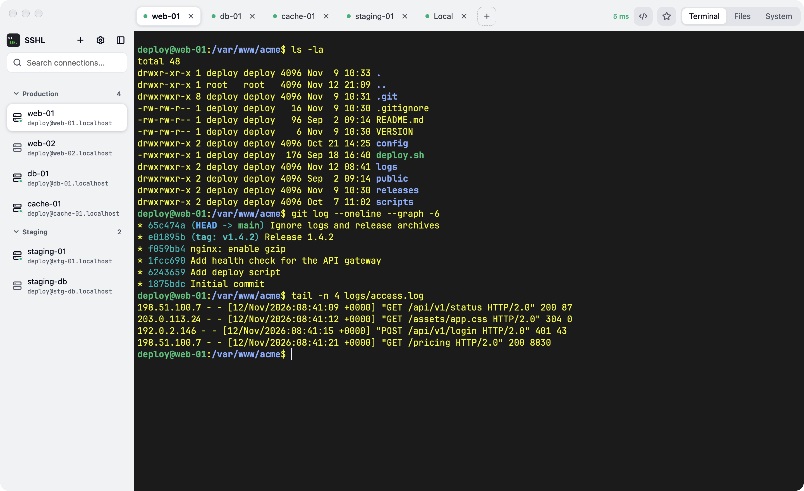
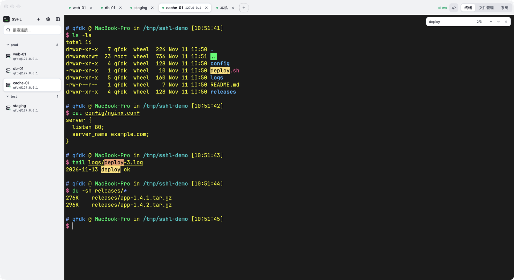
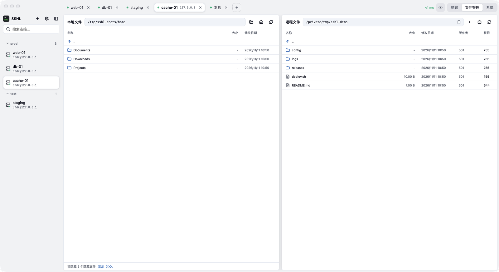

# SSHL

English | [简体中文](README.zh-CN.md)

> Connect. Type. Transfer.

A lightweight native SSH client for macOS: terminal and SFTP file manager in one window. Pure Rust — the UI is built with GPUI (GPU-rendered), terminal emulation is libghostty-vt (the Ghostty core), and the backend is russh + russh-sftp. No WebView; cold start takes about 0.3 seconds.



| Find in terminal (⌘F) | File manager (⌘O) |
| --- | --- |
|  |  |

## Features

**Terminal**
- Parsed by libghostty-vt and drawn on the GPU. JetBrainsMono Nerd Font is built in, so icons and Powerline glyphs work out of the box
- Wide characters (CJK, emoji) stay aligned; input method composition is drawn at the cursor
- Adjustable font and font size; pick a system font or set a custom `fontFamily`
- Color schemes: Carbonfox by default, plus Tokyo Night, Dracula, Catppuccin, Gruvbox, Nord, One Dark, Solarized, GitHub Light and more. A new scheme applies immediately, including to text already on screen
- Dark mode for the interface: follow the system, light, or dark (Settings › Appearance)
- Interface in English and Simplified Chinese; follows the system language by default
- When a sudo / su password prompt appears, fill in a saved password with one click. One host can store several accounts
- Local terminal (⌘N): a login shell. A new tab starts in the current local tab's directory, files dragged in from Finder insert their path, and `exit` closes the tab
- Find (⌘F): searches the screen and the whole scrollback, highlights matches, Enter jumps through them
- ⌘-click a URL to open it in the browser (wrapped long links and program-declared hyperlinks both work); ⌘+ / ⌘- / ⌘0 change the font size
- Switch tabs with ⌘1 … ⌘9, ⌘⇧[ / ⌘⇧] (or ⌃Tab / ⌃⇧Tab); double-click or right-click a tab to rename it
- Switch between Terminal / Files / System with ⌘I / ⌘O / ⌘P
- Snippets (⌘⇧P): save frequent commands and run them with Enter. A snippet can be shared by all servers or belong to one
- Directory favorites (⌘⇧D): star the directories you use often and `cd` there with Enter (in the file manager it jumps directly). Each server has its own list, and so does the local terminal; favorites can be named
- After a disconnect the tab and its screen stay; press Enter to reconnect in place

**Connections**
- Password or private key authentication (including key passphrases). With the key set to "Auto", SSHL logs in through `~/.ssh/config` and the SSH agent without asking. Hosts can be imported from `~/.ssh/config`
- Quick connect (⌘K): type a few letters and press Enter; a connection that is already open is switched to instead
- Groups, with drag-and-drop to reorder and move between groups in the sidebar. The sidebar can be hidden entirely (⌘B) so the terminal takes the full width
- A background pool of pre-warmed connections plus `TCP_NODELAY` make the first connection fast, and the first screen of output is never lost or reordered

**File manager**
- Local and remote panes side by side; drag the divider to resize
- Upload and download files and directories: transfers queue up one at a time, show speed and time remaining, and can be stopped midway. If a file with the same name exists, SSHL asks whether to overwrite or skip
- Follows the terminal: wherever you `cd` in the terminal, the file manager goes too. After `sudo -i` in the terminal, the file manager also works as root
- Drop a file onto the terminal to upload it to the terminal's current directory; star remote directories you use often (⌘D)
- Create remote directories, change permissions (common modes in one click) and ownership
- SFTP reuses the existing SSH session, so no extra connection is made

**System** (⌘P)
- Load, memory, disk, uptime
- Three lists — processes, listening ports, systemd services — with search and sorting. You can kill processes, start / stop services, and toggle start-on-boot

## Getting started

### Download

Download the macOS build from [Releases](https://github.com/qfdk/sshl/releases), unzip it, and drag it into Applications.

The app is not signed or notarized. Before the first launch, run this once in a terminal (it clears the quarantine flag and signs the app locally):

```bash
xattr -cr /Applications/SSHL.app
codesign --force --deep -s - /Applications/SSHL.app
```

When you connect to a host on your local network, macOS asks for the "Local Network" permission — allow it. If you get `No route to host`, enable SSHL in System Settings → Privacy & Security → Local Network. Run the two commands above again after every upgrade.

### Build from source

Requirements: Rust (the version is pinned in `rust-toolchain.toml`; rustup installs it automatically) and [Zig](https://ziglang.org) 0.17 (`brew install zig`, used to build libghostty-vt).

```bash
git clone https://github.com/qfdk/sshl
cd sshl
cargo run -p sshl             # development build
cargo test --workspace        # tests
scripts/bundle.sh             # build SSHL.app
```

The app is written to `target/release/bundle/SSHL.app`. `scripts/deploy.sh` installs it into /Applications (and re-signs it if a Developer ID certificate is available on your machine).

## Data storage

- Connections, groups, and encrypted credentials live in SQLite (`~/.sshl/sshl.db`)
- The encryption key is stored separately in `~/.sshl/master.key` (mode 0600)
- Host keys are recorded in `~/.sshl/known_hosts`. Hosts already trusted in `~/.ssh/known_hosts` are trusted directly (that file is only read, never written)

## Security

- Passwords and key passphrases are encrypted with AES-256-GCM. The key is kept apart from the database, so a copied or synced database cannot be decrypted on its own
- Host keys: on first connection SSHL shows the fingerprint and records it only after you confirm. If the key changes later, you are warned and decide whether to trust the new key (protection against man-in-the-middle attacks)
- Password filling happens entirely in the backend; the plaintext never reaches the UI layer. The fill button only appears when the terminal shows a password prompt

## License

[GNU General Public License v3.0](LICENSE) (GPL-3.0) — derivative works must be released under the same license.

## Sponsor

<a href="https://voilapro.app/?ref=github-sshl"></a>

This project is sponsored by [Voilà Pro](https://voilapro.app/?ref=github-sshl), a voice input tool for macOS. Hold a shortcut and speak, and the text lands at your cursor — mixed Chinese, English and French are recognized too.
