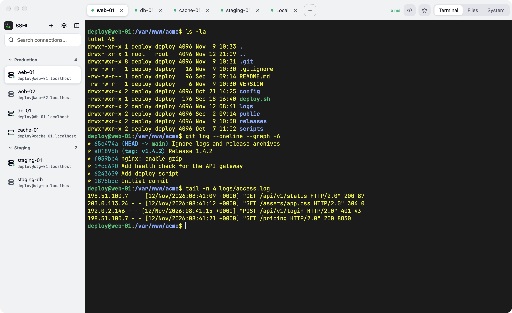
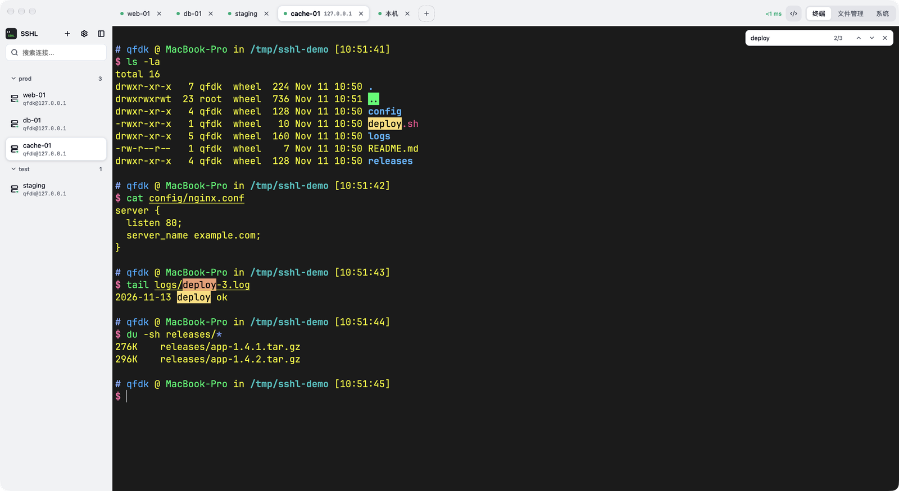
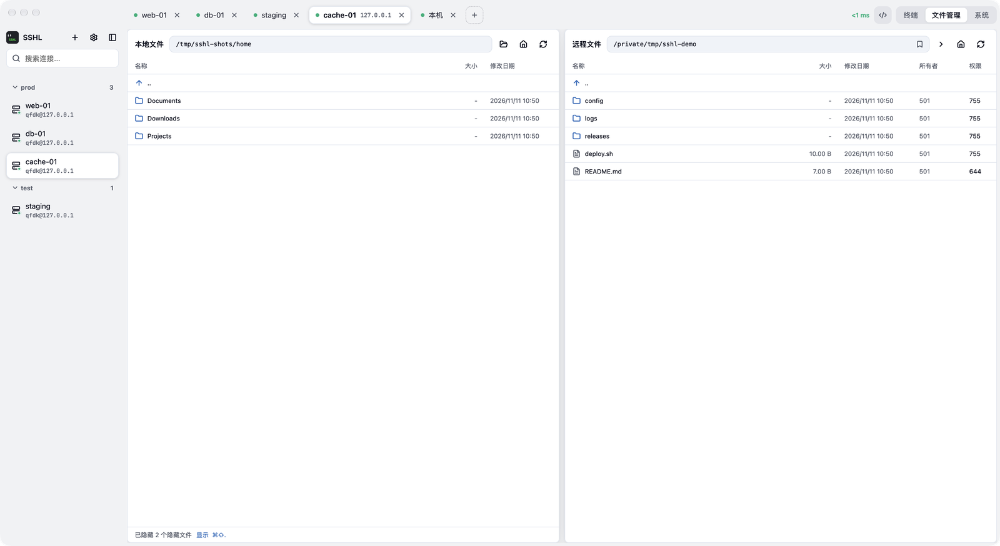

# SSHL

[English](README.md) | 简体中文

> Connect. Type. Transfer.

轻量级原生 macOS SSH 客户端：终端 + SFTP 文件管理放在同一个窗口。纯 Rust：界面用 GPUI（GPU 渲染），终端模拟用 libghostty-vt（Ghostty 内核），后端 russh + russh-sftp。不用 WebView，冷启动约 0.3 秒。



| 终端里查找（⌘F） | 文件管理（⌘O） |
| --- | --- |
|  |  |

## 功能

**终端**
- libghostty-vt 解析、GPU 绘制，内置 JetBrainsMono Nerd Font，图标与 Powerline 字形开箱可用
- 中文、emoji 宽字符对齐；中文输入法组字直接在光标处
- 字体、字号可调，可选系统字体或自定义 `fontFamily`
- 配色可选：默认 Carbonfox，另有 Tokyo Night、Dracula、Catppuccin、Gruvbox、Nord、One Dark、Solarized、GitHub Light 等深浅主题，选了立即生效，屏幕上已有的内容也跟着换色
- 界面深色模式：设置 › 外观里选跟随系统 / 浅色 / 深色
- 界面语言：简体中文 / English，默认跟随系统
- 终端出现 sudo / su 密码提示时一键填入已保存的密码，同一台机器可存多个账号
- 本机终端（⌘N）：登录 shell，新标签沿用当前本机标签的目录；从 Finder 拖文件进来填入路径；`exit` 即关标签
- 查找（⌘F）：搜屏幕和全部回滚历史，匹配处高亮，回车逐个跳
- 按住 ⌘ 点击网址用浏览器打开（折行的长链接、程序标注的超链接都认）；⌘+ / ⌘- / ⌘0 调字号
- 标签切换 ⌘1 … ⌘9、⌘⇧[ / ⌘⇧]（或 ⌃Tab / ⌃⇧Tab）；双击标签或右键可重命名
- 终端 / 文件管理 / 系统 用 ⌘I / ⌘O / ⌘P 切换
- 命令片段（⌘⇧P）：常用命令存起来，回车执行；可以所有服务器通用，也可以只给某一台用
- 目录收藏（⌘⇧D）：常用目录点星星收藏，回车就 `cd` 过去（文件管理页里是直接跳转）；每台服务器一份，本机终端也有；收藏可以起名字
- 掉线后标签和屏幕内容都留着，按回车原地重连

**连接管理**
- 密码 / 私钥（含私钥密码）认证；私钥选「自动」时按 `~/.ssh/config` 和 SSH Agent 免密登录；可从 `~/.ssh/config` 导入主机
- 快速连接（⌘K）：敲几个字母回车就连，已经开着的直接切过去
- 分组管理，侧边栏拖拽排序、跨组移动；侧边栏可整个收起（⌘B），终端占满宽度
- 后台预热连接池 + `TCP_NODELAY`，首次连接快，首屏输出不丢不乱序

**文件管理**
- 本地 / 远程双栏，拖动调整面板宽度
- 文件与目录上传下载：排队一个一个传，显示速度和剩余时间，可以中途停止；遇到同名文件先问覆盖还是跳过
- 跟着终端走：终端 cd 到哪，文件管理就到哪；终端里 `sudo -i` 之后，文件管理也以 root 身份操作
- 把文件拖到终端上，直接上传到终端当前目录；常用的远程目录可以收藏（⌘D）
- 新建远程目录，修改权限（常用权限一键选）与属主
- SFTP 复用已建立的 SSH 会话，不额外建连

**系统**（⌘P）
- 负载、内存、磁盘、运行时间
- 进程、监听端口、systemd 服务三个列表，可搜索、排序；可以结束进程、启停服务、开关开机启动

## 快速开始

### 下载安装

从 [Releases](https://github.com/qfdk/sshl/releases) 下载 macOS 版本，解压后拖入「应用程序」。

应用未签名、未公证，首次使用前在终端执行一次（清除隔离标记并本地签名）：

```bash
xattr -cr /Applications/SSHL.app
codesign --force --deep -s - /Applications/SSHL.app
```

连接局域网主机时 macOS 会请求「本地网络」权限，请允许；若报 `No route to host`，到 系统设置 → 隐私与安全性 → 本地网络 打开 SSHL。每次升级后重新执行上面两行。

### 手动构建

需求：Rust（版本由 `rust-toolchain.toml` 固定，rustup 自动安装）、[Zig](https://ziglang.org) 0.17（`brew install zig`，编译 libghostty-vt 用）

```bash
git clone https://github.com/qfdk/sshl
cd sshl
cargo run -p sshl             # 开发版
cargo test --workspace        # 测试
scripts/bundle.sh             # 构建 SSHL.app
```

产物在 `target/release/bundle/SSHL.app`。`scripts/deploy.sh` 把它装到 /Applications（本机有 Developer ID 证书时重签）。

## 数据存储

- 连接、分组与加密后的凭据存于 SQLite（`~/.sshl/sshl.db`）
- 凭据加密密钥单独存放在 `~/.sshl/master.key`（权限 0600）
- 主机公钥记录在 `~/.sshl/known_hosts`；`~/.ssh/known_hosts` 里已经认可的主机直接信任（只读不写）

## 安全说明

- 密码与私钥密码用 AES-256-GCM 加密；密钥与数据库分离，数据库被拷走或同步也解不出密码
- 主机密钥：首次连接时显示指纹请你确认，确认后才记录；之后密钥变了会提醒，由你决定是否信任新密钥（防中间人）
- 自动填密码全程在后端完成，明文不经过渲染层；只有终端出现密码提示时才显示填充按钮

## 许可证

[GNU General Public License v3.0](LICENSE)（GPL-3.0）——衍生作品须以相同许可证开源。

## 赞助

<a href="https://voilapro.app/?ref=github-sshl"></a>

本项目由 [Voilà Pro](https://voilapro.app/?ref=github-sshl) 赞助支持 —— macOS 语音输入工具。按住快捷键说话，文字直接落到光标处，中英法混说也能识别。
